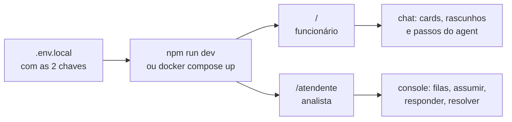
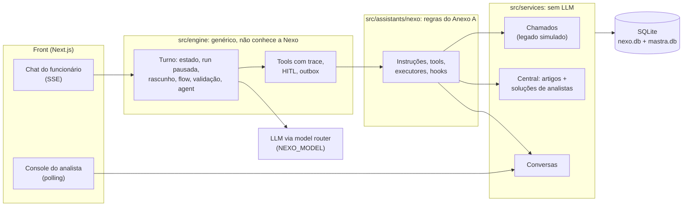
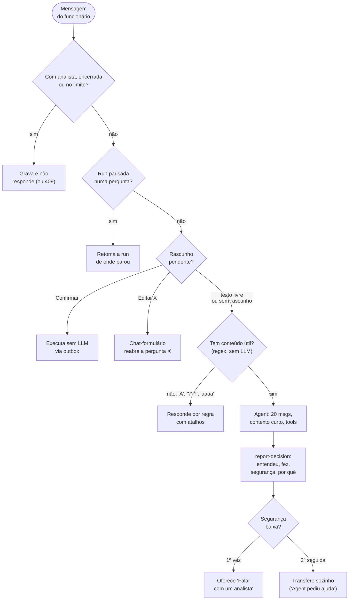
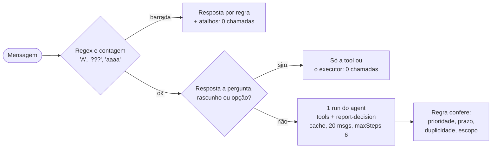
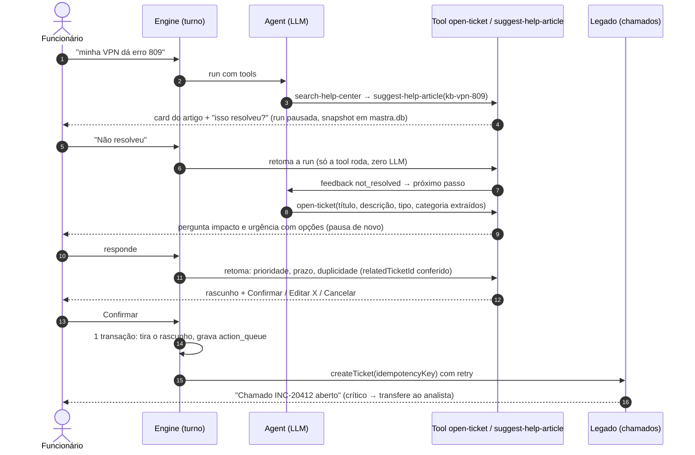
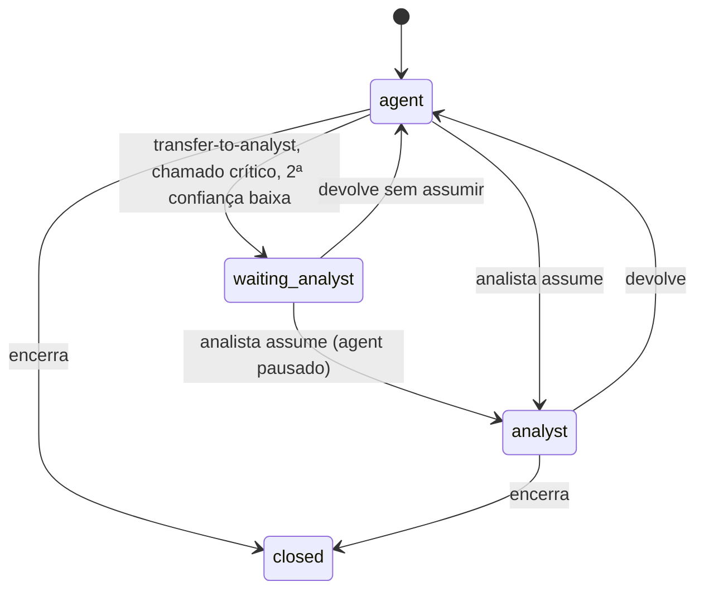
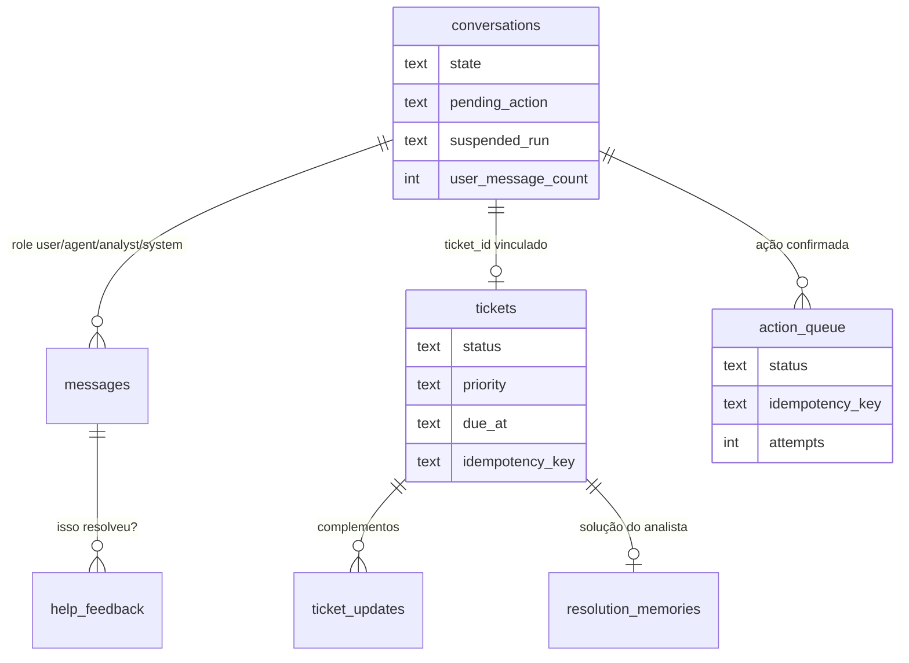
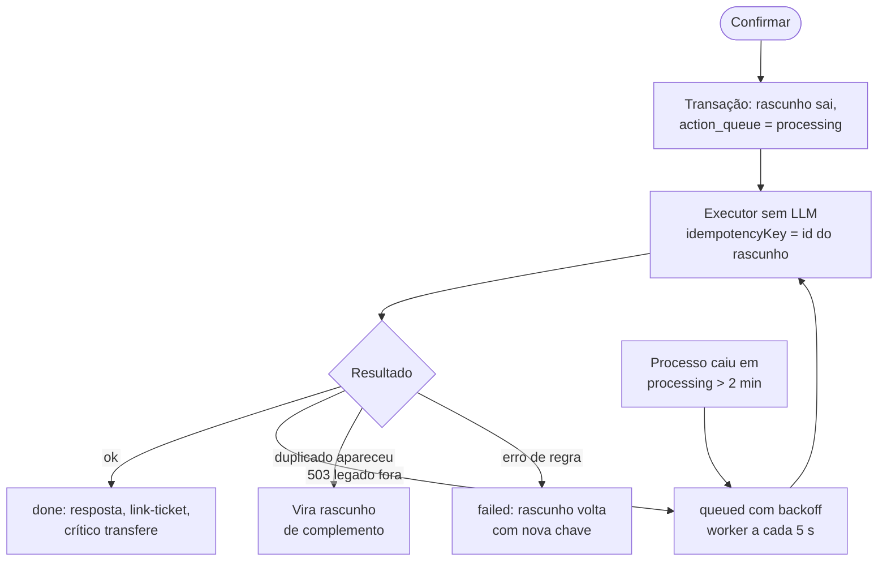

# Nexo Assist

> **Resumo**: agent de service desk de TI em chat. O funcionário descreve o problema; o agent consulta a central de ajuda, consulta/abre/complementa chamados e chama um analista quando precisa. O chat é um **engine reutilizável** (não conhece a Nexo) com a persona "Nexo Assist" plugada por configuração.

## 1. Rodar

```bash
cp .env.example .env.local   # preencha OPENAI_API_KEY e NEXO_AUTH_SECRET
npm install && npm run dev   # http://localhost:3000 (Node 22.5+; SQLite criado e semeado no 1º acesso em ./data)
```



**Logins de teste** (dados de exemplo do seed, fictícios; **a senha é qualquer texto**):

| Papel | E-mail | Entra em |
|---|---|---|
| Funcionário (Financeiro) | `ana.souza@nexo.com` | `/` chat com o assistente |
| Funcionário (Vendas) | `bruno.lima@nexo.com` | `/` |
| Funcionário (Marketing) | `carla.mendes@nexo.com` | `/` |
| Funcionário (Engenharia) | `diego.rocha@nexo.com` | `/` |
| Funcionário (Pessoas) | `elisa.martins@nexo.com` | `/` |
| **Analista** (Suporte N1) | `fabio.nunes@nexo.com` | `/atendente` console do analista |
| **Analista** (Suporte N2) | `gabriela.castro@nexo.com` | `/atendente` |

Para ver o fluxo completo, abra duas abas (ou uma janela anônima): funcionário no chat e analista no console. O login decide a tela pelo papel; um analista que abrir `/` é levado ao console.

- Docker: `cp .env.example .env`, preencha as chaves, `docker compose up --build` (volume `nexo-data` guarda o banco).
- `npm test` (sem rede) · `npm run typecheck` · `npm run seed` recria os dados de exemplo · `npm run load` simula 2.000 funcionários sem custo de modelo (seção 7).

**Por onde olhar.** Em um minuto: abra um chamado como funcionário e veja o raciocínio em "Ver raciocínio" no console do analista. No código, três pontos: a abertura de chamado pausa a run do agent e retoma com a resposta do funcionário (seção 5); a confirmação vira outbox com chave de idempotência, então o legado pode cair sem duplicar chamado (seção 7); o trace de decisão fica com o analista, o funcionário vê só as ações (seção 8).

**Deploy.** Sem banco externo: o SQLite roda no container. Qualquer hospedagem que construa um `Dockerfile` serve, com as variáveis de `.env.example` e `NODE_ENV=production`. Sem volume persistente, cada deploy ou reinício recria o banco a partir do seed; com volume (como no `docker compose`), os dados ficam.

## 2. Visão geral



`engine` nunca importa `assistants/*`; a persona importa `engine` e `services`; `services` não sabe o que é agent. O agent só vê dados por tools, e as tools recebem o usuário logado pelo `requestContext`: privacidade garantida no código, não no prompt. Contratos e invariantes em [docs/brain/index.md](docs/brain/index.md).

## 3. Como o agent decide

Cada mensagem passa por `src/engine/conversation/turn.ts` nesta ordem ([Turn](docs/brain/functions/Turn.md)):



Tools: `search-help-center`, `cite-articles`, `suggest-help-article`, `list-my-tickets`, `get-my-ticket`, `open-ticket`, `add-ticket-update`, `reopen-ticket`, `transfer-to-analyst`, mais `suggest-quick-replies` e `report-decision`.

O modelo só entra na última caixa. Tudo antes dela é regra: estado, run pausada, rascunho e a validação da mensagem. A seção seguinte mostra onde isso corta custo.

## 4. Decisões de IA e custo

O PRD coloca aqui o centro do desafio, e foi onde o esforço se concentrou. Princípio: **a IA decide só o que exige entender linguagem** (qual é o problema, qual artigo se aplica, como conduzir). Tudo que é fato, regra do Anexo A ou efeito colateral é código determinístico, testado e com custo zero de modelo. Nos pontos mistos a IA propõe e a regra confere. Resultado: menos chamadas ao modelo e comportamento previsível justamente onde há efeito colateral.



Onde o custo foi cortado, do mais frequente ao mais raro:

- **Validação da entrada por regex** ([InputPolicy](docs/brain/conventions/InputPolicy.md)): caractere solto, só símbolos ou emoji, repetição e só números recebem resposta por regra com "Abrir um chamado" / "Falar com um analista". Motivação medida no painel do provedor: uma mensagem "A" custava duas chamadas (texto + `report-decision`) para responder "não entendi". Conservadora: "oi", "ok", "vpn", "INC-20311" passam; palavras reais sem sentido vão ao modelo. O composer roda a mesma função e nem envia. A política é da persona (`inputPolicy`), não constante do código.
- **Perguntas do chamado sem LLM**: impacto, urgência, afetados e "isso resolveu?" pausam a run; a resposta reexecuta só a tool. Um chamado completo custa uma run para extrair e uma para concluir, não uma por pergunta.
- **Confirmar, cancelar, editar e cliques em opção** são interpretados por regra (opção clicada ou regex de texto curto); só texto ambíguo diante de um rascunho vai ao modelo.
- **Prioridade, prazo, duplicidade, reabertura, escopo e privacidade** são código (`services/tickets/*`, `scope.ts`): o modelo nunca arbitra o Anexo A.
- **Tipo e categoria sem classificador extra**: o agent pré-preenche o que o funcionário já disse; faltou, a tool pergunta com opções.
- **Busca lexical** na central e nas soluções de analistas; **resumo do assistente** no console montado das mensagens já gravadas. Nenhuma chamada nova ao modelo.
- **Limites**: 30 mensagens por conversa, janela de 20, `maxSteps` 6, instruções estáveis (nada de data ou usuário nelas) para o cache de prompt do provedor.

| Ponto | Quem decide | Onde | Por quê |
|---|---|---|---|
| Mensagem tem conteúdo útil? | Regra (regex/contagem; política por persona) | `engine/conversation/inputGuard.ts`, `turn.ts` | Caractere solto ou símbolos custavam duas chamadas ao modelo para responder "não entendi". |
| Conversa aceita mensagem? (encerrada, limite de 30, analista na conversa) | Regra | `turn.ts` | Estado é fato, não interpretação. |
| "Confirmar", "cancelar", "editar X" diante do rascunho; cancelar uma pergunta | Regra (opção clicada ou regex de texto curto); texto ambíguo vai à IA com o rascunho no contexto | `engine/actions/pending.ts`, `engine/flows/runner.ts` | Confirmação de efeito colateral não pode depender de interpretação. |
| Quais perguntas faltam para o chamado e em que ordem | Regra (passos do chat-formulário; a tool pergunta pausando a run) | `assistants/nexo/flows/openTicket.ts`, `tools/ticketActions.ts` | Responder às perguntas reexecuta só a tool: zero chamadas ao modelo. |
| Tipo (INC/REQ) e categoria | IA pré-preenche quando o funcionário já disse; regra pergunta com opções quando falta | `tools/ticketActions.ts` | Sem LLM extra; uma pergunta a mais quando há dúvida. |
| Prioridade e prazo | Regra (matriz impacto × urgência do Anexo A; horas/dias úteis) | `services/tickets/priority.ts`, `sla.ts` | Regra de negócio auditável; o modelo não arbitra prioridade. |
| É duplicado ou reabertura? | IA indica o chamado relacionado quando reconhece paráfrase; regra confere em três camadas (flow, rascunho, transação) | `services/tickets/dedup.ts`, `ticketService.ts` | A IA cobre sinônimos a custo zero; a regra impede gravação dupla mesmo em paralelo. |
| Assunto é de TI? | Instrução ao modelo + guarda lexical conservadora na `open-ticket` | `assistants/nexo/scope.ts` | Sinal claro de RH/financeiro/facilities nunca vira chamado; na dúvida o modelo decide. |
| Quais chamados o funcionário pode ver | Regra (filtro por usuário em toda tool) | `tools/tickets.ts`, `services/tickets` | Privacidade no código, não no prompt. |
| Criar, complementar ou reabrir chamado | Regra: só após "Confirmar", pelo outbox com chave de idempotência | `turn.ts`, `engine/actions/queue.ts` | Nenhum efeito colateral depende de o modelo "prometer". |
| Transferir para analista | IA chama a tool (pedido, crítico, vencido, insegurança); regra transfere sozinha ao criar chamado crítico e após duas respostas seguidas com confiança baixa | `tools/transfer.ts`, `actions.ts`, `turn.ts` | O modelo reconhece o caso; o engine garante os casos do Anexo A sem depender dele. |
| "Isso resolveu?" | Regra para clique e respostas claras; IA lê o texto quando ambíguo (`unclear`) | `tools/helpCenter.ts` | Métrica de resolução sem gastar modelo nos casos óbvios. |
| Buscar na central e nas soluções de analistas | Regra (busca lexical: título > tags > corpo) | `services/helpCenter/helpCenterService.ts` | Determinística e suficiente para dezenas de itens; embeddings quando a base crescer. |
| Qual artigo se aplica e o que dizer ao funcionário | IA | `instructions.ts`, tools `suggest-help-article` / `cite-articles` | É o trabalho do modelo: entender o problema e conduzir. |
| Entender o problema, pedir detalhes, redigir a resposta | IA | `instructions.ts` | Idem; as instruções limitam o tom e proíbem inventar status e procedimentos. |
| Confiança da resposta | IA declara (`report-decision`, categórica); regra usa como gatilho de segurança | `engine/tools/wrap.ts`, `turn.ts` | Autodeclaração não é calibrada, por isso vira categoria e gatilho, não percentual. |

**Em escala.** A validação é configuração da persona (`AssistantConfig.inputPolicy`: mínimo de caracteres, só números ou não, classe de caracteres, dica, atalhos) e o cliente recebe a mesma política em `conversation.inputPolicy`. Como produto vira um registro por tenant com tela de administração (a mesma tabela de personas prevista em multi-persona), e as notas do trace (`entrada sem conteúdo útil (<motivo>)`) medem quantas mensagens foram barradas e por quê, para ajustar a política sem tocar em código.

## 5. Fluxo ponta a ponta: resolver ou abrir chamado



Perguntas intermediárias não chamam o LLM. "Resolveu" encerra sem chamado e grava o acerto do artigo ([HelpFeedback](docs/brain/entities/HelpFeedback.md)); a solução que o analista escreve ao resolver vira memória pesquisável, só título, categoria e solução ([ResolutionMemory](docs/brain/entities/ResolutionMemory.md)). Detalhes: [HumanInTheLoop](docs/brain/services/HumanInTheLoop.md), [PendingAction](docs/brain/services/PendingAction.md).

## 6. Estados e dados





Só o engine e o analista mudam o estado; só em `agent` o assistente responde. Uma conversa tem no máximo um entre flow ativo, rascunho e run pausada. Migrações versionadas em código ([Persistence](docs/brain/conventions/Persistence.md)).

## 7. Resiliência



- Chave de idempotência única em `tickets`/`ticket_updates`: reexecutar nunca grava duas vezes ([ActionQueue](docs/brain/services/ActionQueue.md)).
- Duplicidade em três camadas: o agent indica o chamado relacionado, o rascunho compara por similaridade, o serviço recompara na transação de gravação.
- Tools nunca lançam para dentro do modelo: erro vira `{ error, message }` e nota no trace. Legado fora (`NEXO_TICKETS_OUTAGE_RATE`) tem retry com backoff e circuit breaker: quem encontra a falha faz as tentativas; quem chega nos 2 s seguintes recebe "instável" na hora, sem segurar a conexão ([LegacyOutage](docs/brain/conventions/LegacyOutage.md)).
- Throttling onde limita custo sem recusar tráfego legítimo: um turno por conversa por vez (`409 TURN_IN_PROGRESS`, o segundo envio não vira outra chamada ao modelo), limite de 30 mensagens por conversa, polling do funcionário e do console com `ETag`/`304` e pausado com a aba oculta. Rate limit por IP ficou de fora: em 2.000 pessoas o problema é o volume agregado, e um `429` só trocaria lentidão por recusa.
- Testes: regras em `src/services/tickets/*.test.ts`, runner roteirizado sem rede, integração com modelo Mastra simulado, ponta a ponta de duplicidade em `src/assistants/nexo/flows/dedup.validation.test.ts`.

### Carga: 2.000 funcionários sem custo de modelo

O PRD situa a Nexo em cerca de 2.000 funcionários. Para testar essa escala sem gastar com o provedor, `NEXO_MODEL=stub/nexo` troca o Mastra por um runner determinístico no mesmo seam que os testes usam ([LoadTesting](docs/brain/conventions/LoadTesting.md)): decide por palavras-chave, chama as mesmas tools e grava o mesmo trace; nenhuma chave é exigida. Todo o resto (rotas, engine, SQLite, SSE, outbox, simulação do legado) é o caminho de produção.

```bash
npm run build
NODE_ENV=production NEXO_MODEL=stub/nexo NEXO_FAST_MODEL=stub/nexo NEXO_AUTH_SECRET=<16+ chars> \
  NEXO_DB_PATH=$PWD/data/load.db PORT=3100 node .next/standalone/server.js      # caminho absoluto: o standalone muda o cwd
NEXO_DB_PATH=$PWD/data/load.db npm run load -- --base http://localhost:3100 --employees 2000 --concurrency 100
```

O script cria 2.000 funcionários de carga no banco, e cada um faz login, lista conversas, abre uma, manda 4 mensagens por SSE (chamados, central, uma barrada por regra, texto livre), cada uma seguida do polling incremental e de um polling ocioso com `If-None-Match` (o caso comum da aba aberta), e lista os próprios chamados, conferindo que só vê o que é dele. Resultado medido (WSL2, 16 vCPU, um processo Node, 100 em paralelo, `NEXO_TICKETS_OUTAGE_RATE=0`):

| endpoint | n | erros | p50 ms | p95 ms | p99 ms |
|---|---:|---:|---:|---:|---:|
| `POST /api/auth/login` | 2000 | 0 | 394 | 867 | 1184 |
| `POST /api/conversations` | 2000 | 1 | 596 | 1092 | 1602 |
| turno por SSE (até `message.end`) | 7996 | 0 | 714 | 1167 | 7562 |
| `GET .../messages?after=` (polling) | 7996 | 0 | 694 | 1092 | 1562 |
| idem, ocioso com `If-None-Match` (304) | 7996 | 0 | 652 | 934 | 1380 |
| `GET /api/tickets` | 1999 | 0 | 414 | 862 | 1153 |

~149 req/s e ~37 turnos/s por processo (a primeira rodada, antes do breaker, do 304 e da trava de turno, deu ~100 req/s, ~33 turnos/s e p50 do turno de 1,2 s), zero violação de privacidade, zero evento `error` no SSE, 2.000 mensagens respondidas por regra sem modelo, 7.996 de 7.996 pollings ociosos em 304. Com 100 clientes em laço fechado a latência é concorrência ÷ vazão, por isso o p50 fica em ~0,7 s: o limite é o processo único com SQLite síncrono, não a rede.

Com a simulação do legado ligada (`NEXO_TICKETS_OUTAGE_RATE=0.05`, padrão), a vazão é a mesma. Como a probabilidade é por chamada, sob carga as janelas de 2 s se encadeiam e o legado fica "fora" quase o tempo todo; o que o breaker muda é o custo disso: o p95 do turno que consulta chamados caiu de 3,4 s para 1,2 s e o p50 do `GET /api/tickets` de 2,9 s para 0,4 s, porque ninguém mais espera 2,1 s de retries para receber a mesma resposta "instável". Em troca, mais turnos recebem essa resposta na hora (84%, antes 54%). É a simulação escalando com o tráfego, não um defeito do engine. O teste achou e corrigiu um defeito real: `database is locked` no worker da fila quando outro processo escreve (faltava `busy_timeout`). Para 2.000 abas abertas e visíveis ao mesmo tempo, o polling ainda é o gargalo (~330 req/s, agora quase todo 304): SSE também para o funcionário é o passo seguinte.

## 8. Transparência

Cada resposta grava um `trace` ([DecisionTrace](docs/brain/entities/DecisionTrace.md)): ações com rótulo humano ("consultou seus chamados", "classificou a prioridade: Alta"), a decisão de `report-decision` (o que entendeu, o que fez, segurança alta/média/baixa, por quê), modelo, tokens e duração. No SSE os rótulos chegam antes do texto. Para o funcionário ficam acima da resposta ("consultou seus chamados", "montou o chamado"), sem painel técnico; no console do analista, **"Ver raciocínio"** abre o detalhe completo (decisão, passos, notas do engine, modelo, tokens) e já vem aberto quando a segurança foi baixa. A confiança é categórica porque o modelo não tem calibração que justifique um percentual.

## 9. API

Cookie httpOnly `nexo_session` ou `Authorization: Bearer <token>` (HMAC). Contratos: [ChatApi](docs/brain/functions/ChatApi.md), [AnalystConsoleApi](docs/brain/functions/AnalystConsoleApi.md).

| Rota | |
|---|---|
| `POST /api/auth/login` `{email,password}` · `GET /api/auth/me` · `POST /api/auth/logout` | sessão |
| `GET/POST /api/conversations` · `GET /api/conversations/:id` · `GET .../:id/messages?after=` | minhas conversas e polling |
| `POST /api/conversations/:id/messages` `{text}` ou `{optionId}` | turno; `Accept: text/event-stream` responde SSE |
| `GET /api/tickets` · `GET /api/tickets/:id` · `GET /api/help-center?q=` | só os meus chamados; central |
| `GET /api/analyst/conversations?state=&q=` · `.../:id` · `POST .../:id/take\|messages\|return\|close` · `POST /api/analyst/tickets/:id/resolve` | console |

```bash
T=$(curl -s localhost:3000/api/auth/login -H 'content-type: application/json' -d '{"email":"ana.souza@nexo.com","password":"x"}' | jq -r .token)
C=$(curl -s -X POST localhost:3000/api/conversations -H "authorization: Bearer $T" | jq -r .id)
curl -N localhost:3000/api/conversations/$C/messages -H "authorization: Bearer $T" -H 'accept: text/event-stream' -H 'content-type: application/json' -d '{"text":"minha vpn dá erro 809"}'
```

## 10. Decisões de arquitetura e trade-offs

| Decisão | Alternativa rejeitada | Por quê |
|---|---|---|
| **Mastra + model router** (`NEXO_MODEL=openai/gpt-6-luna`) | SDK do provedor no projeto | tools tipadas com zod, `requestContext`, stream de tool calls, suspend/resume; trocar de provedor é mudar uma string; instruções estáveis entram no cache de prompt |
| **Human-in-the-loop dentro da run** | chat-formulário fora do agent | o modelo retoma com a resposta no contexto; perguntas intermediárias custam zero LLM; depende de `__registerMastra` (API interna), coberto por teste |
| **Tipo/categoria sem LLM extra** | classificador por mensagem | o agent pré-preenche o que extraiu e a tool pergunta o resto com opções; previsível, ao preço de uma pergunta a mais |
| **Busca e duplicidade lexicais** | RAG / embeddings | determinístico e suficiente para dezenas de itens; sinônimos ficam com o `relatedTicketId` que o agent indica e o código confere; embeddings entram trocando só `searchKnowledge` |
| **Outbox em SQLite, worker no processo** | executar na hora e torcer | confirmação nunca se perde; em produção o worker seria dedicado e a presença "digitando…" iria para um store compartilhado |
| **Polling no console** | SSE por conversa | funciona em qualquer hospedagem; `ETag`/`304` e pausa com a aba oculta tiram quase todo o custo; SSE é o passo seguinte |
| **Throttling por conversa e breaker, sem rate limit por IP** | `429` por usuário/IP | o custo por pessoa já é limitado (um turno por vez, 30 mensagens); com 2.000 pessoas legítimas um `429` só troca lentidão por recusa; o próximo guarda-corpo é um semáforo nas chamadas ao modelo (limite real: RPM/TPM do provedor) |
| **Confiança categórica** | percentual | o modelo não é calibrado; um número daria precisão falsa |
| **Validação de entrada por regex** | classificador por mensagem | custo zero e sem falso positivo em mensagens curtas legítimas ("oi", "vpn"); palavras reais sem sentido ainda vão ao modelo, que pede detalhes (seção 4) |

**O que ficou de fora e por quê.** Guardrails por classificador com confiança (`NEXO_FAST_MODEL`, `inputProcessors` do Mastra) para escopo, INC/REQ e texto sem sentido que o regex não pega: o regex cobre os casos medidos e um classificador erraria em mensagens curtas legítimas, então ficou como próximo passo. Persistência no deploy gratuito: sem volume, o disco é efêmero (seção 1). Também não feitos: promover memória recorrente a artigo da FAQ; multi-persona (tabela de personas, chaves por integrador); avaliação automática com conversas de referência contra o modelo real. As decisões e invariantes deste README vivem em [docs/brain](docs/brain/index.md), mantido junto com o código a cada mudança.
